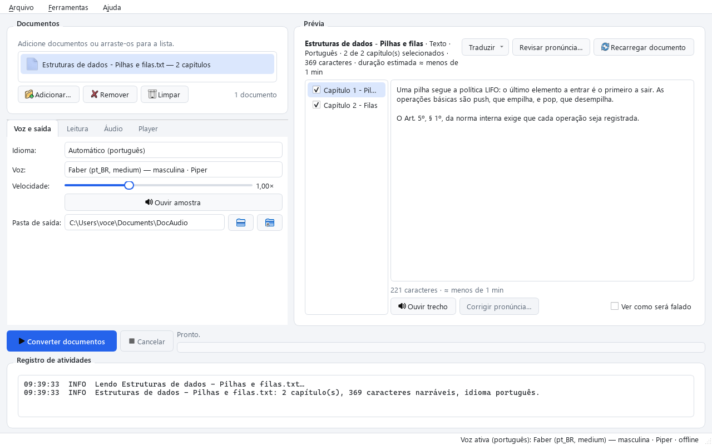
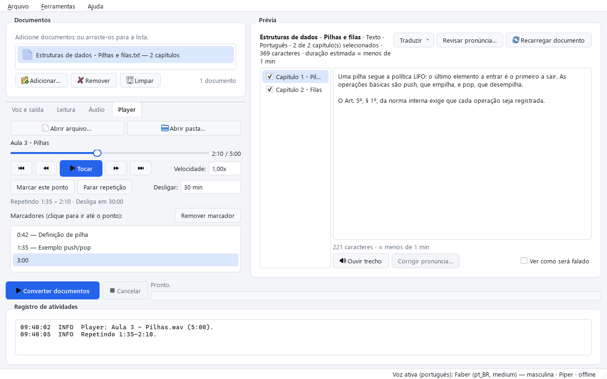
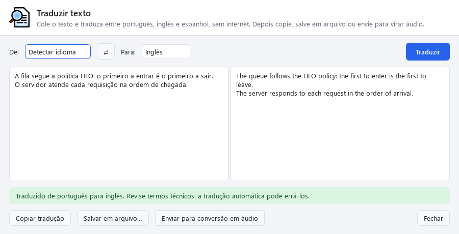

# DocAudio

Converte apostilas, livros e documentos em audiolivros, **sem internet**. Feito para estudar em português: lê PDF (inclusive digitalizado), Word, PowerPoint, EPUB, HTML e TXT, mostra uma prévia editável e gera MP3 ou audiolivro com capítulos. Também lê e traduz textos em inglês e espanhol.

Roda no Windows. Todo o processamento (OCR, voz e tradução) acontece no computador, então os documentos não saem da máquina.



## O que ele faz

**Leitura de documentos**
- PDF com texto ou digitalizado (OCR em paralelo), DOCX, PPTX, EPUB, HTML e TXT.
- Divide em capítulos pelos títulos do documento; cabeçalhos, rodapés e números de página repetidos ficam de fora.
- Prévia editável: escolha capítulos, corrija trechos e ouça um parágrafo antes de converter.
- Blocos de código, tabelas e notas são reconhecidos e podem ser lidos ou pulados.

**Narração em português**
- Números, datas, valores, siglas e abreviações são escritos por extenso antes da leitura ("R$ 2,50", "Art. 5º, § 1º", "séc. XX").
- Correção automática de palavras sem acento, comum em PDFs mal gerados ("Inicio" → "Início").
- Dicionário de pronúncia editável, com temas prontos: direito, administração pública, contabilidade, saúde, TI e latim.
- Modo questões: lê o enunciado e as alternativas, dá um tempo para pensar e depois fala a resposta do gabarito.

**Vozes offline**
- Piper (Faber, Cadu e Jeff), Kokoro (Dora, Alex e Santa) e as vozes do Windows.
- Vozes em inglês e espanhol para documentos nesses idiomas; o idioma é detectado sozinho.
- Clonagem de voz opcional, a partir de uma gravação de 10 a 30 segundos (ambiente separado, com PyTorch).

**Saída e retomada**
- MP3 por capítulo, ou M4A/M4B únicos com marcadores de capítulo, ou WAV.
- Conversão em fila, que retoma de onde parou se for interrompida.
- Pasta vigiada: documentos colocados nela entram sozinhos na fila.

**Tradução offline** (português, inglês e espanhol)
- Traduz um documento inteiro na prévia para ouvi-lo em outro idioma, ou salva a tradução em Word/TXT sem gerar áudio.
- Janela "Traduzir texto" (Ctrl+T) para colar, traduzir, corrigir e copiar qualquer texto.

**Player embutido**
- Toca MP3, M4A, M4B, WAV, FLAC, OGG, OPUS, WMA e outros, sem instalar codecs.
- Velocidade de 0,5x a 3x sem mudar o tom, capítulos, e continua de onde parou.
- Marcadores, repetição de um trecho (A–B) e timer de desligar (por tempo ou no fim do capítulo).





## Instalar

**Versão pronta:** baixe o ZIP portátil na página de *Releases*, extraia e abra `DocAudio.exe`. A voz Faber e o OCR em português já vêm junto; outras vozes, idiomas e modelos de tradução são baixados uma vez em *Ferramentas → Idiomas e vozes*.

Para gerar MP3 e M4A/M4B, o programa usa o FFmpeg. Instale com:

```powershell
winget install Gyan.FFmpeg
```

Sem o FFmpeg, a conversão funciona em WAV. O Player não precisa dele.

> O executável não é assinado digitalmente, então o Windows pode mostrar o aviso do SmartScreen na primeira vez. Clique em "Mais informações" e "Executar assim mesmo".

## Rodar a partir do código

Requer Python 3.11 ou mais novo, no Windows.

```powershell
python -m venv .venv
.venv\Scripts\python -m pip install -e ".[dev]"
.venv\Scripts\docaudio baixar-voz pt_BR-faber-medium --destino resources/voices
.venv\Scripts\docaudio-gui
```

Se o pip falhar com `CERTIFICATE_VERIFY_FAILED` (proxy ou antivírus que inspeciona HTTPS), use os certificados do Windows com `$env:PIP_USE_FEATURE = "truststore"`.

Dados do OCR (o modelo rápido é o padrão; o preciso é cerca de 10x mais lento):

```powershell
curl -L -o resources\tessdata\por.traineddata https://github.com/tesseract-ocr/tessdata_fast/raw/main/por.traineddata
curl -L -o resources\tessdata_best\por.traineddata https://github.com/tesseract-ocr/tessdata_best/raw/main/por.traineddata
```

### Linha de comando

```powershell
.venv\Scripts\docaudio verificar                               # dependências locais
.venv\Scripts\docaudio vozes                                   # vozes instaladas
.venv\Scripts\docaudio ler apostila.pdf                        # capítulos e blocos extraídos
.venv\Scripts\docaudio converter apostila.pdf --formato mp3    # retoma se interrompido
.venv\Scripts\docaudio converter apostila.pdf --formato m4b --capitulos 1,2
.venv\Scripts\docaudio falar "Texto" -o saida.wav --velocidade 1.2
.venv\Scripts\docaudio baixar-voz pt_BR-cadu-medium
```

O executável aceita os mesmos comandos: sem argumentos abre a interface.

### Testes

```powershell
.venv\Scripts\python -m pytest
```

O corpus sintético (`tests/corpus/sinteticos.py`) é gerado a cada execução. Documentos reais podem ser adicionados em `tests/corpus/reais` com um arquivo `.esperado.json` (veja o LEIA-ME da pasta); eles não são versionados.

### Gerar o executável

```powershell
.venv\Scripts\pyinstaller packaging\docaudio.spec --noconfirm
```

Gera `dist\DocAudio\DocAudio.exe` com a voz de `resources/voices`, os dados de OCR e os binários de `resources/bin`. O script do instalador (Inno Setup 6) está em `packaging/docaudio.iss`.

## Onde ficam os dados

| | A partir do código | Executável |
|---|---|---|
| Configurações, logs, marcadores, vozes e modelos baixados | `data/` | `%LOCALAPPDATA%\DocAudio` |
| Áudios gerados (padrão) | `output/` | `Documentos\DocAudio` |

A variável `DOCAUDIO_DATA_DIR` substitui a pasta de dados.

## Organização do código

| Pasta | Conteúdo |
|---|---|
| `src/docaudio/extractors` | Leitura de PDF, DOCX, PPTX, EPUB, HTML e TXT; OCR e detecção de código |
| `src/docaudio/text_processing` | Normalização pt-BR, números, acentos, pronúncia e divisão em frases |
| `src/docaudio/core` | Modelo do documento, capítulos, conversão com retomada, idiomas, tradução e modo questões |
| `src/docaudio/speech` | Vozes Piper, Kokoro, Windows e clonagem |
| `src/docaudio/audio` | FFmpeg, capas, WAV e o player com PyAV |
| `src/docaudio/ui` | Interface em PySide6 (Qt) |
| `tests` | Testes automatizados (pytest) |

## Limitações conhecidas

- Só para Windows (as vozes do sistema e o empacotamento usam recursos do Windows).
- A tradução automática pode errar termos técnicos; revise antes de usar.
- PDFs com layout muito complexo (várias colunas misturadas com tabelas) podem precisar de ajuste na prévia.

## Licença

DocAudio é software livre, distribuído sob a [GNU Affero General Public License v3.0 ou posterior](LICENSE). Você pode usar, estudar, modificar e redistribuir, desde que versões distribuídas mantenham a mesma licença e o código-fonte disponível. O programa é fornecido sem nenhuma garantia.

A licença segue a das bibliotecas que o DocAudio usa (PyMuPDF é AGPL-3.0 e Piper/espeak-ng são GPL-3.0). Bibliotecas, vozes e modelos de terceiros, com suas licenças, estão em [CREDITOS.md](CREDITOS.md).
